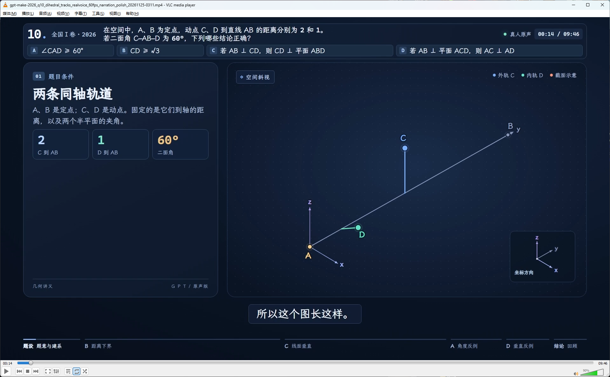

# GPT 真人原声独立版 · 2026 全国Ⅰ卷第 10 题

[观看／下载现版：真人原声精修版（1080p60 · 9 分 46 秒）](https://github.com/SomeVincentZyuMaths/gpt-make-2026_national_1_q10_dihedral_tracks/releases/tag/20261125-0311)

> [!NOTE]
> **口播重录、重制版视频：规划中。** 现版还留有一些口误和停顿，但解题过程完整，足够观看。[重录稿](content/voiceover-rerecord-v1.md)已备好，暂不重录和重剪，先发布现版。



## 本地渲染说明

本地 `remotion` 分支从 `ab27cf0` 独立搭建，使用同一真人母带。原题、3D 坐标与数学函数复用，画面采用 Three.js 正交投影的 SVG 图形、KaTeX 板书和 **LXGW WenKai（霞鹜文楷）字幕**。动画只由帧号决定，随机定位不依赖前一帧。

仓库包含源码、字幕和项目文档，不包含原始录音或录屏。下载现成视频见上方 Release；按原声重新渲染需要自行提供母带。

- `npm ci`，然后 `npm run typecheck` / `npm test`。
- `npm run gpt:subtitles` 从人工整理的 `audio/gpt_voice_subtitles.json` 生成 SRT。
- `npm run gpt:stills` 检查关键帧；`npm run gpt:samples` 出端点与边长接力、向量分量、口播点名的平面和 D 项微斜视短片（输出在对应的临时目录）；`npm run gpt:render` 出 1080p60 全片。
- 需要 `ffmpeg` 和 `ffprobe`。`GPT_VOICE_SOURCE` 可覆盖默认的相邻源仓库母带路径，`GPT_VOICE_TEMP` 可指定渲染临时目录，`GPT_VOICE_CHROME` 可指向已有 Chrome Headless Shell（可选），`GPT_VOICE_CONCURRENCY` 可调并发（默认 4）。Windows 默认用 `D:/temp/codex/gpt-make-2026_national_1_q10_dihedral_tracks` 作为临时目录。
- 口播精修版输出到 `video/archive/`，文件名以 `_narration_polish_YYYYMMDD-HHmm.mp4` 结尾，使用上海时间；同一分钟重复出片则加 `-02` 等后缀，不覆盖旧片。母带按 `src/remotion/gptEdit.json` 剪掉 106 帧对应的音频，再编码为 AAC；渲染脚本检查 35,183 个视频帧、剪后音轨的精确时长及封装前后的 AAC 数据哈希。
- `npm run gpt:subtitles` 导出与现版对齐的 `audio/gpt_voice_subtitles_edited.srt`。Release tag 与成片文件名共用同一个 `YYYYMMDD-HHmm` 时间戳。
- `src/remotion/gptNarrationCues.ts` 逐条记录字幕里的几何指代；脉冲按母带绝对秒定位，遇到下一短语或字幕结束就收束。无具体几何对象的口播不触发强调。
- 全片按分钟保存已校验的渲染段。若渲染中断，把 `GPT_VOICE_RESUME` 设置为对应的 `full-…` 临时目录名，再运行 `npm run gpt:render`；会使用原任务封存的页面包和音频，不会混入之后的代码改动。
- 完整题栏常驻，界面数字优先使用本机 Cascadia Mono（后备 JetBrains Mono）。`src/remotion/gptMotionCues.ts` 管理口播触发的轻量运镜和标记强调；没有提示时回归原机位。
- `src/remotion/gptVectorCues.ts` 单独记录口播向量的动画时间点。右下角坐标图全程显示，随相机转动；正视时用 `⊙` 表示正方向朝向观众，`⊗` 表示正方向进入屏幕。

---

## 原工程：空间双轨道

> 网页互动与 OBS 录屏用 Three.js 动画。已配备开源 Whisper 自动提取与高颜值霞鹜文楷中文字幕。
>
> **原项目仓库**：[SomeVincentZyuMaths/2026_national_1_q10_dihedral_tracks](https://github.com/SomeVincentZyuMaths/2026_national_1_q10_dihedral_tracks)


## 题目与答案

- 题源：2026 年全国 I 卷第 10 题
- 正确答案：BC
- 核心结论：\(CD\) 的最小值为 \(\sqrt3\)；当 \(AB\perp CD\) 时，可推出 \(CD\perp\) 平面 \(ABD\)
- 建系：以 A 为原点，\(AB\) 所在直线为 \(y\) 轴（从 A 指向 B），\(z\) 轴竖直向上，\(x\) 轴按图示垂直于 \(AB\)

## 本地启动

```powershell
npm install
npm run dev
```

默认本地地址：<http://127.0.0.1:62026/>

## 交互与录屏

控制方式与另外两个项目一致：`Space` 播放，方向键切换步骤，`T` 切换主题，`V` 切换画幅，`M` 切换讲解/自由视角，`Home` 或双击复位镜头，`C` 进入录屏模式。两种视角都支持左键旋转、右键平移、滚轮缩放。

本地录屏 · 横屏：

```text
http://127.0.0.1:62026/?mode=capture&theme=dark&ratio=16x9
```

本地录屏 · 竖屏：

```text
http://127.0.0.1:62026/?mode=capture&theme=dark&ratio=9x16
```

可附加 `&step=3`、`&captions=0`、`&autoplay=1`。

附加 `&camera=free` 可让步骤切换不再自动转动相机，适合边讲边自由观察。

原工程的网页讲解共 10 幕，约 2 分 02 秒，与上方真人原声成片是两个版本：`00` 原题、`01` 建系、`02–03` B（投影与取等）、`04–06` C（向量分量、截面直角、线面判定）、`07` A 的 45° 反例、`08` D 的点积反例、`09` 四项回看。

## 文件

- `src/scenes/scene.ts`：两条圆轨道及圆心 O₁、O₂ 标注、动点、平面 ABD 和二维俯视插图
- `src/scenes/dihedralMath.ts`：点坐标、径向距离与最小距离
- `src/main.ts`：十幕脚本、分段字幕与公式；`src/scenes/proofDrawing.ts`：投影、角弧和直角等证明辅助图形
- `content/`：题面、分镜和人工配音提示
- `plan.txt`：早期原声重构交接笔记，仅供回顾；以本 README 和当前代码为准

## 验收

```powershell
npm run typecheck
npm test
npm run build
```
